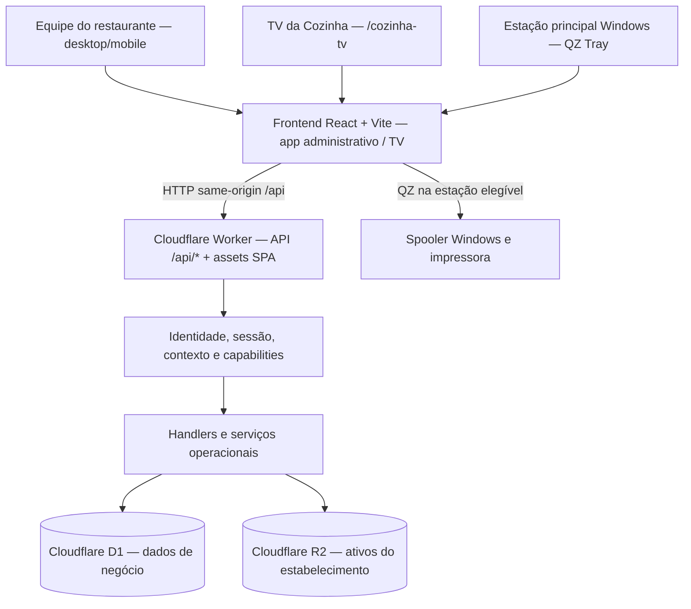
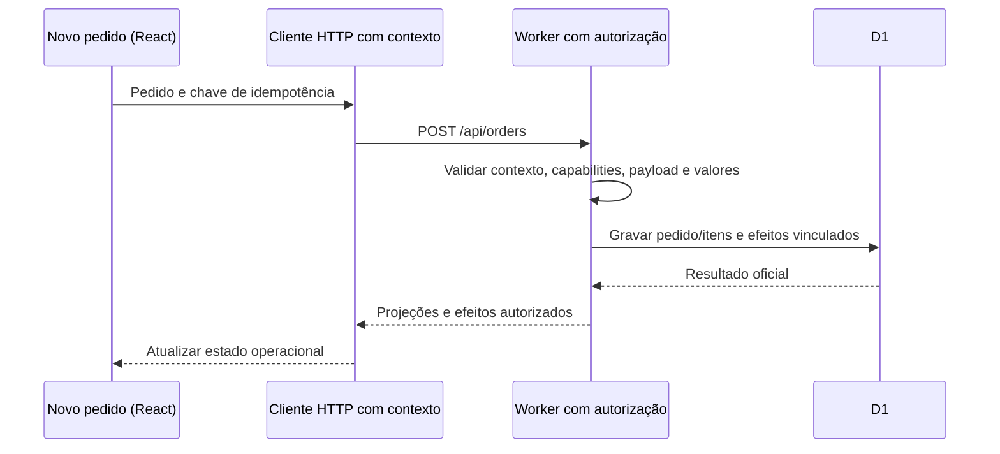
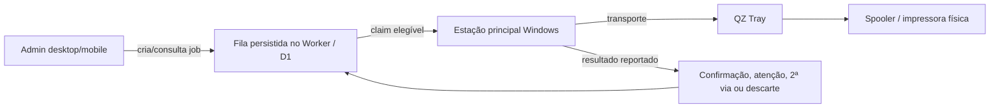

# Mesiva — Arquitetura atual do sistema

- **Tipo:** documentação viva da arquitetura implementada.
- **Versão:** v0.2 — atualização focal em 17/10/2026 (baseline inicial 13/10/2026).
- **Baselines:** arquitetura geral originalmente inspecionada em `master@e595f7ed2a801fde6ffab231194788430cc53316`; atualização de sincronização, consultas e orçamento examinada em `master@9289523f9b3c6094ed8f27a66b05aa527f25d16d` e nos runbooks correntes. As demais áreas não foram reauditas integralmente.
- **Estado da evidência:** inspeção de código, configuração de build/ambientes, checker e workflows. **Não** representa auditoria de cada módulo, execução de testes, inspeção de recursos Cloudflare remotos ou confirmação do SHA publicado em produção.

Este documento responde **como** a Mesiva está organizada e por onde os dados passam. [PRD](../product/PRD.md) responde **o que** ela faz; [Business Rules](../product/BUSINESS_RULES.md) registra **invariantes de negócio**; [AGENTS.md](../../AGENTS.md) rege **como trabalhar**. Para atribuição detalhada de responsáveis e pontos de entrada, consulte o [Module Map](MODULE_MAP.md), sem duplicar esta visão geral.

## 1. Visão geral e limites da solução

A Mesiva é uma aplicação web React para gestão de restaurantes, com **Cloudflare Worker** servindo a API e os assets estáticos, **D1** como persistência autoritativa do negócio e **R2** para ativos de negócio (por exemplo, logo do estabelecimento). O navegador mantém estado de UI e preferências locais, mas não substitui D1 nem confirma gravações quando offline.

O desenho é **conceitual**: o fluxo QZ ocorre apenas na estação física habilitada; a TV usa um bootstrap próprio e endpoints públicos específicos protegidos por pareamento. Nem todo cliente web exerce todos esses papéis. O diagrama não significa que a TV ou a estação de impressão realizem a mesma autenticação de uma sessão administrativa.

**Fontes principais:** [`README.md`](../../README.md), [`wrangler.jsonc`](../../wrangler.jsonc), [`src/main.jsx`](../../src/main.jsx), [`worker/index.js`](../../worker/index.js), [`worker/businessLogoStorage.js`](../../worker/businessLogoStorage.js).

## 2. Stack, artefatos e ambiente

| Camada | Tecnologia / contrato identificado | Referência |
| --- | --- | --- |
| Aplicação web | React 19, React Router 8, Vite 8, JavaScript/JSX | [`package.json`](../../package.json) |
| Compilação | Vite; diretório `dist/`, manifesto de build, alvo compatível com navegadores mais antigos | [`vite.config.js`](../../vite.config.js) |
| API | Cloudflare Workers; entrada `worker/entry.js` e dispatcher `worker/index.js` | [`wrangler.jsonc`](../../wrangler.jsonc), [`worker/entry.js`](../../worker/entry.js) |
| Banco de dados | Cloudflare D1 por ambiente; schema versionado em `migrations/` | [`wrangler.jsonc`](../../wrangler.jsonc), [migrations](../../migrations/) |
| Objetos | R2 `BUSINESS_ASSETS`, com bucket separado em staging | [`wrangler.jsonc`](../../wrangler.jsonc), [`businessLogoStorage.js`](../../worker/businessLogoStorage.js) |
| Integração física | QZ Tray na estação principal Windows e impressora configurada | [`src/infrastructure/qz/`](../../src/infrastructure/qz/), [runbook de impressão](../operations/windows-qz-tray-printing.md) |
| Qualidade | Node.js 22, testes `node --test`, oxlint, checador de arquitetura, CI GitHub Actions | [`package.json`](../../package.json), [`validate.yml`](../../.github/workflows/validate.yml) |

**Atenção a nomes históricos:** o pacote, Worker e bases ainda possuem identificadores internos legados de `sistema-para-delivery`/`amor-e-sabor-delivery`. A marca e os domínios públicos são **Mesiva**. Não renomear IDs de recursos Cloudflare, bancos ou bindings apenas para melhorar a consistência nominal da documentação: isso requer migração/planejamento próprio.

### 2.1 Desenvolvimento versus ambientes remotos

- **Local:** Vite em `127.0.0.1:4173` encaminha `/api/*` ao Worker em `127.0.0.1:8787`. O estado D1 local deve ter persistência consistente e dados **fictícios**; os dois processos são necessários para exercitar a aplicação. `npm run preview`, isoladamente, não inicia a API.
- **Staging:** `https://staging.mesiva.com.br`, Worker, D1 e bucket R2 dedicados para homologação; não é cópia dos dados reais de produção.
- **Produção:** `https://app.mesiva.com.br`, com Worker, D1 e bucket R2 de produção. `workers_dev` está desabilitado na configuração de produção.
- **Fonte de verdade sobre deploy:** [runbook de release](../release-and-migration-runbook.md) e evidências específicas dos workflows. **Ter código na `master` não comprova deploy em produção.**

Fontes: [`README.md`](../../README.md), [`vite.config.js`](../../vite.config.js), [`wrangler.jsonc`](../../wrangler.jsonc).

## 3. Frontend: entradas e composição

### 3.1 Dois bootstraps sob o mesmo site

[`src/main.jsx`](../../src/main.jsx) examina o caminho:

- `/cozinha-tv` importa dinamicamente [`KitchenDisplayRoot.jsx`](../../src/kitchen-display/KitchenDisplayRoot.jsx), com tratamento próprio de compatibilidade/erro e [`KitchenDisplayApp.jsx`](../../src/kitchen-display/KitchenDisplayApp.jsx).
- Outros caminhos carregam [`AdminBootstrap.jsx`](../../src/admin/AdminBootstrap.jsx), que inicializa tema, React e o RouterProvider. O roteador administrativo vem de [`adminRouter.jsx`](../../src/app/navigation/adminRouter.jsx) e do [registro de destinos](../../src/app/navigation/registry.js).

A TV usa um fluxo **separado** de pareamento, sessão e leitura; não é apenas um submenu da aplicação administrativa. O controle da TV **dentro** do aplicativo é uma superfície administrativa em [`src/app/surfaces/kitchen-tv-control/`](../../src/app/surfaces/kitchen-tv-control/).

Há ainda um plugin Vite para importar na TV apenas o contrato público necessário de Pedidos, preservando compatibilidade/tamanho do bundle; revisar [`vite.config.js`](../../vite.config.js) antes de alterar imports do painel.

### 3.2 Organização das responsabilidades

| Diretório | Responsabilidade efetiva |
| --- | --- |
| [`src/app/`](../../src/app/) | Composição de aplicação: shell, roteamento, sessão, sincronização operacional, feedback, notificações, edição de políticas, superfícies transversais e workflows entre domínios |
| [`src/domains/`](../../src/domains/) | Módulos de negócio do frontend, cada um expondo uma API pública `index.js` |
| [`src/shared/`](../../src/shared/) | Componentes, hooks e utilitários genéricos do frontend; não deve depender de domínios |
| [`src/infrastructure/`](../../src/infrastructure/) | Adaptadores de HTTP, autenticação, storage, áudio e QZ; integram com mundo externo |
| [`shared/`](../../shared/) | Contratos e políticas usados tanto pelo frontend como pelo Worker |
| [`src/kitchen-display/`](../../src/kitchen-display/) | Experiência da TV independente da montagem do admin |
| [`src/admin/`](../../src/admin/) | Bootstrap da aplicação administrativa |

Os **10 domínios** identificados são: `access`, `companies`, `platform`, `orders`, `table-service`, `customers`, `catalog`, `finance`, `reporting` e `printing`. A nomenclatura e a posse de cada módulo devem ser descritas em `MODULE_MAP.md`; **não** tratar nomes de pasta como afirmação de desacoplamento total entre capacidades de negócio.

Nem todos os domínios possuem as quatro subpastas: onde presentes, `domain/` guarda regras, `application/` coordena ações/estado, `infrastructure/` fornece adaptadores e `ui/` contém interfaces. Alguns módulos menores possuem apenas `ui/` e `infrastructure/`. Verificar a árvore real antes de aplicar um modelo uniforme.

### 3.3 Regras de dependência verificadas automaticamente

O [checador de limites](../../scripts/architecture/check-import-boundaries.mjs) valida invariantes da modularização, entre outros:

- Domínios consumidores não importam **arquivos internos de outro domínio**; entram por `src/domains/<domínio>/index.js`.
- Camadas `domain/` não dependem de React, browser/fetch, QZ, UI ou implementações de infraestrutura.
- `src/shared/` não importa domínios; o domínio `platform` não passa a consumir indiscriminadamente domínios operacionais.
- Dependências entre domínios não devem formar ciclos; owners legados da modularização anterior não devem ser recriados em `src/pages`, `src/components`, `src/api`, `src/hooks`, `src/utils` ou `src/printing`.

**Escopo:** esse checker protege o **frontend**, inclusive contratos pontuais herdados das Specs C3–C10. Ele **não** significa que cada pasta do Worker possua os mesmos limites de imports, nem substitui testes de comportamento.

Fontes: [`AGENTS.md`](../../AGENTS.md), [`check-import-boundaries.mjs`](../../scripts/architecture/check-import-boundaries.mjs).

### 3.4 Sessão, bootstrap e sincronização no admin

O [App](../../src/App.jsx) compõe [`useSessionRuntime`](../../src/app/runtime/session/useSessionRuntime.js), [`useOperationalDataRuntime`](../../src/app/runtime/data/useOperationalDataRuntime.js), comunicação HTTP por contexto, UI e workflows.

1. O cliente de sessão descobre autenticação e empresa/plataforma ativa; mudança de contexto invalida o estado operacional anterior.
2. O cliente HTTP do contexto fixa `X-Mesiva-Context` e `credentials: same-origin` **na criação da requisição**. Retorno `SESSION_CONTEXT_CHANGED` aciona reconciliação da sessão.
3. A API `GET /api/bootstrap` preserva o contrato legado; com `OPERATIONAL_READ_MODELS_ENABLED` habilitado, um `surface` seleciona o snapshot autorizado à tela. `worker/readModels/snapshotRepository.js` limita coleções completas ao escopo declarado em `readModel.completeCollections`, distinguindo coleções operacionais e totais da página.
4. O runtime oferece avisos WebSocket quando `REALTIME_ENABLED` está habilitado, com reconciliação/fallback HTTP e invalidação por tópicos. Subscripções legadas de **5 segundos** (global) e **2 segundos** (pedidos) permanecem condicionais, não representam necessariamente consultas contínuas em todas as telas. A existência das flags no código não comprova seu estado em cada ambiente ou o custo efetivamente faturado. Foco/retorno visível não deve duplicar silenciosamente owners de dados.
5. Mutations aplicam efeitos oficiais recebidos da API, sem converter um resultado obsoleto de sessão/empresa em sucesso para a nova sessão.
6. Sem conexão, UI sinaliza indisponibilidade e bloqueia escritas pertinentes; **não há fila de mutações offline autoritativas**.

Fontes: [`useSessionRuntime.js`](../../src/app/runtime/session/useSessionRuntime.js), [`contextHttpClient.js`](../../src/infrastructure/api/contextHttpClient.js), [`useOperationalDataRuntime.js`](../../src/app/runtime/data/useOperationalDataRuntime.js), [`snapshotRepository.js`](../../worker/readModels/snapshotRepository.js), [`useScopedQuery.js`](../../src/infrastructure/realtime/useScopedQuery.js), [`worker/index.js`](../../worker/index.js), [runbook realtime](../operations/realtime-sync.md) e [`README.md`](../../README.md).

## 4. Worker: roteamento, segurança e persistência

### 4.1 Entrada e roteamento de API

A entrada de produção [`worker/entry.js`](../../worker/entry.js) reexporta **somente o handler padrão** de [`worker/index.js`](../../worker/index.js). O dispatcher central usa [`routePolicy.js`](../../worker/tenancy/routePolicy.js) para classificar requisições entre:

- **`public-identity`:** login por e-mail, seleção de empresa ou plataforma, sessão, convites e recuperação de identidade (dependendo do endpoint).
- **`platform`:** administração Mesiva, com scope e capabilities globais próprias.
- **`public-tv`:** pareamento/estado/telemetria da TV, sujeitos a controles próprios da TV.
- **`business`:** API operacional autenticada, exigindo contexto de empresa.
- **`unknown`:** caminho não reconhecido, sem fallback aberto que conceda acesso.

A API operacional ainda é uma **composição híbrida**: existe um dispatcher central em `worker/index.js` que atende rotas diretamente e delega famílias a handlers específicos de acesso, configurações, impressão, TV, relatórios, perfil e reservas. Serviços e repositórios vivem em `worker/`, `worker/access/`, `worker/identity/`, `worker/tenancy/`, `worker/platform/` e `worker/reporting/`. **Não** presumir arquitetura de microserviços separados ou um espelho 1:1 dos domínios React.

O Worker também entrega os assets compilados via `ASSETS.fetch` com fallback de SPA; [`wrangler.jsonc`](../../wrangler.jsonc) define `run_worker_first` para `/api/*`.

### 4.2 Contexto de identidade e isolamento entre empresas

- Sessões modernas distinguem scopes **`identity`**, **`business`** e **`platform`**; vínculos e grants podem mudar no servidor. A operação não é autorizada exclusivamente pela visibilidade de menus.
- [`businessContext.js`](../../worker/tenancy/businessContext.js) exige `X-Mesiva-Context` correspondente à sessão e, para rotas operacionais, scope `business`, empresa e sessão válidos.
- [`guardedBusinessDb.js`](../../worker/tenancy/guardedBusinessDb.js) aplica um guard de sessão à execução de consultas/lotes D1 no contexto de uma requisição de empresa; valida sessão, conta, empresa, contexto, credenciais e grants relevantes. Isso reduz o risco de commits após troca/revogação de identidade.
- [`authorization.js`](../../worker/access/authorization.js) exige capabilities por ação; handlers de mutação também exigem origem adequada e validações de payload/política.
- As leituras e respostas para a aplicação podem ser **projetadas** por capabilities e receber atribuições de auditoria. Não confiar no objeto enviado pelo navegador como identidade ou total financeiro canônico.

Fontes: [`sessions.js`](../../worker/identity/sessions.js), [`businessContext.js`](../../worker/tenancy/businessContext.js), [`guardedBusinessDb.js`](../../worker/tenancy/guardedBusinessDb.js), [`authorization.js`](../../worker/access/authorization.js), [`worker/index.js`](../../worker/index.js).

**Importante:** o Worker ainda contém trechos condicionais de compatibilidade com modos de autenticação antigos. O [runbook multiempresa](../operations/multi-company-production.md) registra o corte de produção para e-mail/senha e multiempresa. **Existência do código legado não significa que PIN seja o fluxo operacional ativo.**

### 4.3 D1, migrations, políticas e R2

- O binding D1 é `DB`. Há **banco distinto por ambiente**; entidades operacionais carregam contexto `business_id` e as camadas de acesso/tenancy precisam preservá-lo em leituras e mutações.
- Mutations financeiras, checkout, reservas e configurações usam transações/lotes, validações de regras e, conforme caso, idempotência, revisão esperada e guardas de concorrência. **Não** repetir cegamente escritas cujo desfecho seja incerto.
- Políticas de modalidades/horários, meios de pagamento, cancelamento, categorias e impressão são configurações efetivas **versionadas**, consultadas em [`effectiveBusinessConfig.js`](../../worker/effectiveBusinessConfig.js) e repositórios específicos.
- R2 `BUSINESS_ASSETS` é **armazenamento de objetos**, não banco relacional para pedidos. A implementação de logo de empresa em [`businessLogoStorage.js`](../../worker/businessLogoStorage.js) valida tipos/bytes e usa chaves por estabelecimento.
- Preferências de navegador em [`src/infrastructure/storage/`](../../src/infrastructure/storage/) têm finalidade local, e não substituem registros D1.

Fontes: [`wrangler.jsonc`](../../wrangler.jsonc), [`repositories.js`](../../worker/repositories.js), [`orderCheckout.js`](../../worker/orderCheckout.js), [`paymentRepository.js`](../../worker/paymentRepository.js), [`effectiveBusinessConfig.js`](../../worker/effectiveBusinessConfig.js), [`businessLogoStorage.js`](../../worker/businessLogoStorage.js).

### 4.4 Economia de consultas, sincronização e orçamento Cloudflare

**Invariante de engenharia, não regra financeira do produto:** o [AGENTS.md](../../AGENTS.md#economia-de-recursos-cloudflare--regra-para-futuras-melhorias) estabelece projetar a menor quantidade necessária de consultas, escritas, requests e processamento sem comprometer consistência, isolamento, auditoria, pagamentos ou impressão.

- **Leitura por necessidade e permissão:** a TV obtém apenas candidatos ativos e itens pertinentes em [`kitchenTvReadRepository.js`](../../worker/kitchenTvReadRepository.js); a Cozinha administrativa pode consultar pedidos ativos por [`orderReadRepository.js`](../../worker/orderReadRepository.js); APIs de [`worker/readModels/`](../../worker/readModels/) suportam snapshots por superfície e histórico/financeiro paginados, com agregados oficiais não limitados à página. Evitar carregar todos os pedidos e itens em cada atualização.
- **Sincronização por eventos, não por varredura:** o hub de [`worker/realtime/`](../../worker/realtime/) avisa sobre mudanças confirmadas, enquanto o HTTP/D1 permanece autoridade; o [`useScopedQuery.js`](../../src/infrastructure/realtime/useScopedQuery.js) reaproveita owners/invalidações sem criar polling por consulta. Fallback/reconciliação existem para recuperar eventos perdidos. O cache em memória por empresa/contexto tem invalidação de mutações, revisão e sessão; não substitui autorização nem permite reutilização após troca de empresa.
- **Custo SQL e escrituração:** filtrar por empresa, verificar índices/planos, volume efetivo de `rows_read` **e** `rows_written`; índices podem aumentar custo de manutenção em escritas. Requests de leitura podem conter validações auxiliares de sessão e não devem ser assumidos como zero writes; comparar caminhos completos de API quando exigido. Evitar N+1, joins que iniciam pelo histórico, polling concorrente e novos logs sem necessidade.
- **Gates e dimensionamento:** mudanças no caminho quente devem comparar baseline e nova consulta com **mesmos candidatos, permissões e volume de histórico**, medir D1 em workerd e contabilizar Workers/CPU, Durable Objects, R2, armazenamento, requests, falhas e modo degradado. [`operational-read-d1-benchmark.mjs`](../../scripts/infra/operational-read-d1-benchmark.mjs) e [`realtime-runtime-gate.mjs`](../../scripts/infra/realtime-runtime-gate.mjs) são entradas dos gates; não bastam, isolados, para provar economia mensal. Consulte [orçamento operacional D1](../operations/operational-data-read-budget.md), [sincronização e custo Cloudflare](../operations/realtime-sync.md) e [incidente de leitura na impressão](../operations/printing-d1-read-incident.md).
- **Tecnologia alternativa requer evidência:** avaliar cache versionado, índices/consultas diferentes, Durable Objects, R2, replicação ou particionamento somente após medir gargalo e comparar custo total, consistência, segurança, migrations, manutenção e rollback. Não considerar réplica D1 como redução automática de linhas faturáveis nem acrescentar serviço apenas por expectativa de economia.

A arquitetura com flags, caches e caminhos legados exige conferir **SHA, configuração efetiva do ambiente e métricas reais** antes de declarar algo publicado, desligado ou financeiramente aprovado. O [roteiro de custo e escala](../superpowers/plans/2026-10-14-mesiva-scale-roadmap.md) contém hipóteses de carga e margens de planejamento, não garantias de franquia de cobrança.

## 5. Fluxos entre frontend, API e serviços

### 5.1 Novo pedido e recebimento

**Separação de fluxos:** pedido salvo sem pagamento não é pedido quitado; `Salvar e receber` ou recebimento posterior usam composição em alocações. Pedido vinculado a mesa/comanda tem caminho de quitação próprio. Pagamento e status do preparo são independentes.

- Cliente e rascunho: [`orderCart.js`](../../src/domains/orders/domain/orderCart.js), [`ordersApi.js`](../../src/domains/orders/infrastructure/ordersApi.js).
- Backend e pagamento: [`orderCheckout.js`](../../worker/orderCheckout.js), [`paymentValidation.js`](../../worker/paymentValidation.js), [`paymentRepository.js`](../../worker/paymentRepository.js).
- Regra funcional detalhada: [`BUSINESS_RULES.md`](../product/BUSINESS_RULES.md).

### 5.2 Reserva, comanda e financeiro

- As **mesas** e **comandas** são persistidas e consultadas pela API de operação. Uma mesa ocupada corresponde a comanda aberta; transferência exige checagens de identidade/ocupação.
- Uma reserva local `reserved` é um fluxo diferente da comanda `open`: a confirmação de chegada faz a conversão e vincula o pedido mediante verificação de data, revisão, mesa e status.
- O pagamento da comanda quita os pedidos pendentes vinculados e fecha a comanda conforme regras vigentes. Uma composição pode gerar **um recibo e vários movimentos** por alocação, preservando rastreabilidade.
- Financeiro/relatórios consomem projeções autorizadas. A área de relatórios possui serviço/queries próprios no Worker e suporte de exportação no frontend; não é correto inferir que exportações são gravadas permanentemente no R2.

Fontes: [`tableRepository.js`](../../worker/tableRepository.js), [`tableReservationArrival.js`](../../worker/tableReservationArrival.js), [`paymentRepository.js`](../../worker/paymentRepository.js), [`worker/reporting/`](../../worker/reporting/), [`src/domains/reporting/`](../../src/domains/reporting/).

### 5.3 Impressão e recuperação

O Worker coordena elegibilidade, prioridade, tentativas, status e política de cópias. A execução física usa `src/infrastructure/qz/` na estação principal Windows. Um envio de bytes **não** deve ser tratado como confirmação física automática, e um resultado incerto não autoriza retry cego. A segunda via exige transição própria e pode ser pulada com registro de descarte. Há descarte em lote de jobs elegíveis, sem descartar trabalho em processamento ou com tentativa não resolvida.

Fontes: [`orderPrintingApi.js`](../../worker/orderPrintingApi.js), [`orderPrintingRepository.js`](../../worker/orderPrintingRepository.js), [`printJobRunner.js`](../../src/domains/printing/application/printJobRunner.js), [`printQueue.js`](../../shared/printQueue.js), [`printContextPolicy.js`](../../shared/printContextPolicy.js), [runbook Windows/QZ](../operations/windows-qz-tray-printing.md).

### 5.4 TV da Cozinha e controle remoto

- A TV usa [`KitchenDisplayApp.jsx`](../../src/kitchen-display/KitchenDisplayApp.jsx), endpoints de pareamento e sessão específicos em [`kitchenTvApi.js`](../../worker/kitchenTvApi.js), além de estados projetados do pedido.
- O controle administrativo (no Gestor) persiste **página solicitada**, **modalidade** e IDs ocultados. A TV aplica esse controle, reportando página efetiva, quantidade de páginas, viewport e pedidos visíveis.
- O filtro por `all`, `delivery`, `pickup` e `table` altera a **exibição**, não a situação oficial de preparo nem o recebimento dos pedidos.
- A TV trata navegadores sem recursos necessários de forma própria; compatibilidade real depende do dispositivo/navegador, não é garantida pelo alvo de build `chrome69`.

Fontes: [`main.jsx`](../../src/main.jsx), [`KitchenDisplayApp.jsx`](../../src/kitchen-display/KitchenDisplayApp.jsx), [`kitchenTvControlRepository.js`](../../worker/kitchenTvControlRepository.js), [`kitchenTvModality.js`](../../shared/kitchenTvModality.js).

## 6. Concorrência, erros e observabilidade

| Risco | Proteção/contrato a respeitar | Ponto inicial de inspeção |
| --- | --- | --- |
| Sessão, empresa ou grants alterados durante uma operação | Marker de contexto do HTTP client; invalidação no runtime; revalidação e guarda de sessão no Worker/D1 | [`contextHttpClient.js`](../../src/infrastructure/api/contextHttpClient.js), [`guardedBusinessDb.js`](../../worker/tenancy/guardedBusinessDb.js) |
| Duplo clique, retry ou resposta perdida | Chaves de idempotência/identificadores de mutação, verificação do estado e reconciliação específica | [`orderCheckout.js`](../../worker/orderCheckout.js), [`settingsTransactions.js`](../../worker/settingsTransactions.js) |
| Configuração desatualizada | Revisões esperadas e proteção contra uso de políticas que mudaram durante o fluxo | [`operationSettingsRepository.js`](../../worker/operationSettingsRepository.js), [`operationalPolicyGuards.js`](../../worker/operationalPolicyGuards.js) |
| Subscrições/respostas fora de ordem | Guards por coleção, contexto e versão antes de aplicar efeitos no frontend | [`useOperationalDataRuntime.js`](../../src/app/runtime/data/useOperationalDataRuntime.js) |
| Falha/incerteza física na impressão | Attempts persistidos, confirmação/atenção, ações de recuperação explícitas | [`printAttemptRepository.js`](../../worker/printAttemptRepository.js), [`orderPrintingRepository.js`](../../worker/orderPrintingRepository.js) |
| Erros de API e auditoria | Erros HTTP com código/estado; auditoria de mutações e atribuição operacional | [`http.js`](../../worker/http.js), [`worker/access/audit.js`](../../worker/access/audit.js), [`worker/index.js`](../../worker/index.js) |

**Não** inferir tracing distribuído, broker de mensagens, cache compartilhado, WebSocket, processamento assíncrono genérico ou filas externas: esses componentes não foram estabelecidos nesta baseline. O runtime observado usa polling/foco/visibilidade, API HTTP e fila de impressão persistida.

## 7. Validação e publicação

A verificação automatizada é orquestrada por [`validate.yml`](../../.github/workflows/validate.yml): testes Node em **8 shards**, checker de arquitetura, lint, build, dry-run dos Workers de produção/staging e gates D1 locais/de migração. Os comandos locais estão no [`package.json`](../../package.json) e o procedimento completo no [`README.md`](../../README.md).

Os workflows operacionais são distintos:

1. [`Deploy staging`](../../.github/workflows/deploy-staging.yml): publicação de homologação com gate de validação, migrations/staging, smoke e checagem de SHA. Na baseline há **allowlist explícita de branches** para staging automático/manual; **não presumir** que qualquer branch de documentação será publicada automaticamente.
2. [`Deploy production`](../../.github/workflows/deploy-production.yml): acionamento **manual**, apenas da `master`, com verificação de validação/staging do SHA, controles de migrations e smoke em produção.
3. Código mergeado não significa automaticamente publicação; produção depende de autorização e workflow próprios. Não copiar dados reais para local ou staging.

As validações físicas (especialmente impressora, estações e compatibilidade da TV) exigem homologação em dispositivos reais quando alteradas. Esta atualização documental não substitui QA da aplicação.

## 8. Onde alterar sem romper contratos

| Se a mudança é… | Comece por… | Verifique também… |
| --- | --- | --- |
| Menu, rotas, páginas e capabilities | [`src/app/navigation/registry.js`](../../src/app/navigation/registry.js) e [`src/app/navigation/`](../../src/app/navigation/) | Guards de acesso, deep links e desktop/mobile |
| Comportamento do pedido | [`src/domains/orders/`](../../src/domains/orders/) e [`worker/orderCheckout.js`](../../worker/orderCheckout.js) | Contratos de pagamento/comandas, sincronização, TV e impressão |
| Pagamento/comanda/reserva | [`src/app/workflows/payments/`](../../src/app/workflows/payments/), [`worker/paymentRepository.js`](../../worker/paymentRepository.js) e [`worker/tableReservationApi.js`](../../worker/tableReservationApi.js) | Concorrência/revisão, movimentos e QA |
| Configuração | [`src/app/surfaces/settings/`](../../src/app/surfaces/settings/), [`worker/settingsApi.js`](../../worker/settingsApi.js) | Revisões, política efetiva e permissões |
| Impressão | [`src/domains/printing/`](../../src/domains/printing/), [`worker/orderPrintingApi.js`](../../worker/orderPrintingApi.js) | QZ, estados de atenção, física, runbook e capabilities |
| TV da Cozinha | [`src/kitchen-display/`](../../src/kitchen-display/) e [`worker/kitchenTvApi.js`](../../worker/kitchenTvApi.js) | Pareamento, navegadores/TV, projeção e controle remoto |
| Contas/empresa/plataforma | [`worker/identity/`](../../worker/identity/), [`worker/tenancy/`](../../worker/tenancy/), [`worker/platform/`](../../worker/platform/) | Contexto, revogação e isolamento; runbook multiempresa |
| Relatórios | [`src/domains/reporting/`](../../src/domains/reporting/) e [`worker/reporting/`](../../worker/reporting/) | Capacidades, definição de métricas, período, exportação |

Antes de editar: confirmar o SHA da branch, seguir imports/consumidores, especificar impacto, manter testes e checker de arquitetura, atualizar [PRD](../product/PRD.md)/[regras de negócio](../product/BUSINESS_RULES.md) **somente se afetados**. Não alterar recursos Cloudflare/migrations remotas por suposição.

## 9. Limites e evolução documental

Esta é uma **visão de alto nível**, baseada no código do SHA indicado; não contém mapa de todas as tabelas/índices, matriz completa das capabilities, ERD, catálogo exaustivo de endpoints, inventário de classes CSS ou medições de performance. Essas informações exigem levantamento focalizado e pertencem a documentos especializados quando houver necessidade.

Próximos desdobramentos planejados:

- **[Module Map](MODULE_MAP.md):** ownership por domínio, exports públicos, contratos entre módulos e pontos de teste; criado na mesma PR documental.
- **[Design System](../design/DESIGN_SYSTEM.md):** componentes/tokens/temas, fontes da marca e divergências documentadas; **revisão formal do guia no Drive ainda pendente**.
- **Documentação de decisões arquiteturais (ADRs):** registrar novas decisões significativas e sua substituição, se isso for adotado como processo; **não** afirmar que ADRs existem hoje.
- **Verificação de status de deploy por release:** quando necessário, conferir o SHA implantado diretamente nas evidências do ambiente.

### Referências normativas e operacionais

- [Índice documental](../README.md), [PRD](../product/PRD.md), [Business Rules](../product/BUSINESS_RULES.md) e [Module Map](MODULE_MAP.md).
- [AGENTS.md](../../AGENTS.md), [README.md](../../README.md).
- [Runbook de release e migrations](../release-and-migration-runbook.md), [operação multiempresa](../operations/multi-company-production.md), [impressão Windows/QZ](../operations/windows-qz-tray-printing.md).
- [Checker de arquitetura](../../scripts/architecture/check-import-boundaries.mjs) e [Validate application](../../.github/workflows/validate.yml).

**Manutenção:** registrar PR/commit que altere arquitetura e atualizar este documento na mesma entrega. Quando comportamento e texto divergem, investigar e corrigir a documentação ou a implementação **com decisão e evidência**, sem reescrever silenciosamente specs históricas.
