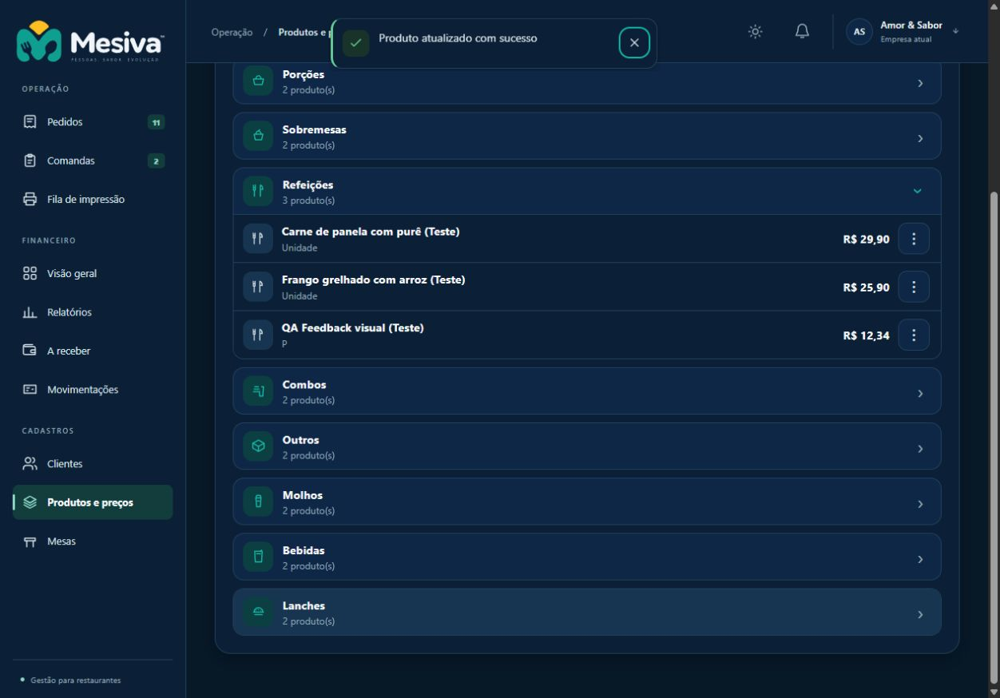

# QA — feedback de ações

**Data:** 19/10/2026. **Ambiente:** worktree local, branch `codex/melhorias-visuais-2026-10-19`, Vite `127.0.0.1:4173` e Worker local `127.0.0.1:8787`. Dados fictícios existentes preservados; produto `QA Feedback visual (Teste)` criado para a conferência.

**Baseline:** `90482c31` (plano aprovado, antes do código). **Implementação:** `1f793bec` → `409b807a`; ajustes de QA em `d32e4a91` e correção da revisão em `abd74b0d`. **Status:** implementação e revisão concluídas; staging autorizado posteriormente pelo proprietário, com execução e aceite acompanhados no PR.

## Comportamento e evidências

| Cenário | Evidência |
| --- | --- |
| Envio e fechamento de formulário | No catálogo real, criar/editar produto mostrou `Salvando…`, campos/botão bloqueados e um toast de sucesso após fechar. Não há atraso para exibir check. |
| Botão persistente | No cenário isolado com `Button`/`ToastRegion` reais, envio → check `Salvo` → retorno a idle. Testes do `SettingsEditorShell` cobrem resultado oficial, 1.800 ms, edição durante envio, troca de recurso e `false`. |
| Mobile | Viewport de 320 × 720: mensagem longa sem overflow horizontal, alvo de fechar medido em 44 × 44 px, ações e rodapé acessíveis. Desktop conferido no catálogo e no cenário isolado. |
| Temas | Mesiva e Clássico, claros/escuros, conferidos no cenário isolado usando os tokens reais; fluxo integrado conferido em Mesiva escuro. Não houve alteração de preferência do usuário. |
| Fila | Quatro eventos no cenário isolado exibem três; o quarto entra depois da saída. Erro longo permaneceu até fechamento. Testes com relógio controlado cobrem FIFO, eventos iguais distintos e tempos de 4/6 s. |
| Teclado e pausas | Fechamento por botão focável, foco visível e região de anúncio conferidos no navegador; Escape no editor real fechou o modal e restaurou foco em Adicionar produto (zero diálogos restantes). Testes cobrem foco/hover/documento oculto simultâneos, tempo restante, unmount, reset e ausência de restart por rerender. |
| Movimento reduzido | Emulação CDP de `prefers-reduced-motion: reduce`: QA detectou uma regra de conteúdo ainda animada; ajuste de especificidade em `d32e4a91` deixou todas as animações do botão em `none`, mantendo `aria-busy` e rótulo. Override removido após ensaio. |
| Operações | Testes de pedidos/pagamentos/estornos, clientes/produtos, mesas/comandas e configurações verificam os owners existentes; falso/resultado incerto não confirma sucesso. Transferência identifica origem/destino. Impressão distingue envio de conclusão física. |

[Check do botão em 320 px](evidence/2026-10-19-action-feedback/mobile-check.png) · [Erro longo em 320 px](evidence/2026-10-19-action-feedback/mobile-error.png). As duas capturas mobile usam o cenário isolado, sem API ou gravação; a captura desktop usa o fluxo real local.

## Verificações

- Tarefas 1–5: testes focados executados com RED → GREEN e marcos locais no histórico; 82 testes de configurações/controller na última integração.
- Primeira suíte completa: **4.129 testes, 4.120 passaram, nove falhas reportadas** (inclui um teste pai). Causas: expectativa antiga de toast em configuração, busca pelo texto bruto que agora inclui os rótulos de medição, região `alert` vazia adicional e fixture de `navigator` sem `onLine`. Corrigidas sem enfraquecer permissões, concorrência, reconciliação ou isolamento; 100 testes focados passaram após os ajustes.
- `npm run test:architecture`: código 0. `npm run lint`: código 0, com avisos. `npm run build`: código 0, aviso de chunks acima de 500 kB. Não foi feita uma medição comparativa de todos os avisos de lint com a baseline.
- Suíte final `npm test -- --test-concurrency=4` em `d32e4a91`: **4.129/4.129 passaram**, zero falhas/cancelamentos/skip, código 0, duração de 238 s.
- `git diff --check e70a0ad7 HEAD`: código 0. Links locais dos documentos alterados conferidos no fechamento.

## Revisão independente

Revisão read-only do diff completo em `bae35030`: zero Critical, um Important/P2 e zero Minor. O controller confirmava uma reconsulta antes do próximo render, e o shell descartava o check por ainda observar `unconfirmed`. Em `abd74b0d`, a confirmação oficial é retida para a mesma tentativa/rascunho e só aparece/inicia seu timer quando o estado já está `ready`. Nenhum novo write ou retry.

Teste integrado com controller real reproduziu o anúncio vazio (RED) e passou com `Salvo` e duração de 1.800 ms (GREEN). Contagens preservadas: um write original, duas leituras do recurso no total (inicial e reconciliação), uma consulta de recibo. Controller/shell: 39/39 passaram. Suíte após a correção em `abd74b0d`: **4.130/4.130 passaram**, código 0, sem falhas/cancelamentos/skip, 262 s. Arquitetura/lint/build repetidos com código 0; dry-runs Worker de produção e staging com Wrangler 4.128.0 passaram. Não houve segunda revisão nem minores adiados.

## Requests e custo

Comparação em harness Vite, carregando o mesmo owner de transferência em `90482c31` e na árvore correspondente a `d32e4a91`, com adaptador instrumentado e as mesmas tabelas/intenção. Contagens são de chamadas ao adaptador e ao refresh oficial, não benchmark de D1:

| Cenário da rota `POST /api/tables/:id/transfer` | Antes: writes / refresh | Depois: writes / refresh |
| --- | --- | --- |
| Aceita | 1 / 0 | 1 / 0 |
| Conflito 409 | 1 / 1 | 1 / 1 |
| Intenção obsoleta | 0 / 1 | 0 / 1 |

O teste comparativo passou nos três cenários. Testes dos owners de pagamento/configuração e submissão duplicada preservam seus contratos existentes. Nenhuma alteração de endpoint, SQL, cache, eventos remotos ou infraestrutura de runtime; os timers novos apenas alteram apresentação local. **Sem impacto esperado em requests/consultas**, pela ausência de efeitos de rede nos timers/fila. `rows_read`/`rows_written`: sem medição D1 adicional, SQL inalterado. Nenhuma promessa de economia mensal; não extrapolar este ensaio para histórico volumoso ou vários dispositivos.

## Documentação, referências e limites

Atualizados [Design System](../../design/DESIGN_SYSTEM.md) e [Module Map](../../architecture/MODULE_MAP.md) para os contratos e owners atuais. README e AGENTS revisados; instruções de instalação/operação continuam corretas. Removidas somente as apresentações globais de sucesso/toast substituídas e uma mensagem de transferência sem consumidor.

Referências visuais e licenças conferidas antes da integração: Spectrum UI Morph Button (Apache-2.0) e Joly UI Animated Toast (MIT, Copyright 2025 Johuniq), vinculados na [spec](../specs/2026-10-19-action-feedback-design.md). Adaptação nativa JSX/CSS/SVG; sem dependências novas ou cópia da infraestrutura sugerida pelo exportador.

Não executados: leitor de tela real, zoom nativo do navegador, todos os fluxos manuais em todas as combinações de tema/dispositivo ou impressão física. O ensaio de 320 px confere reflow estreito, sem representar certificação de zoom/acessibilidade. Cenários de foco/modal e demais fluxos também contam com a suíte automatizada existente. Viewport/emulação temporários restaurados, cenário de QA fechado e servidores/banco preservados. Merge e produção não autorizados. Após esta QA, o proprietário autorizou push, novo PR e staging; incluída apenas a branch exata na elegibilidade manual do workflow, preservando CI/PR/SHA e destinos existentes. Teste de elegibilidade RED → GREEN; 59 testes de segurança/deploy passaram. Execução remota e identidade publicada são registradas no PR, sem alterar este SHA para anexar resultados.

## Refinamento do alinhamento dos toasts — 19/10/2026

Após o teste do proprietário, o alinhamento ao topo (`align-items: flex-start`) foi substituído por `center` no componente compartilhado. Texto, ícone e fechamento ficam no mesmo centro vertical, incluindo mensagens curtas, longas e com título. Ensaio no componente real em desktop e 320 × 720: desvio entre centro do texto e da caixa de 0 px nas três variantes; nenhum overflow horizontal. Sem mudança de conteúdo, duração, eventos ou requests. Arquitetura, lint e build passaram; CI e staging da atualização são acompanhados no PR #122. README/AGENTS e demais owners continuam corretos.
